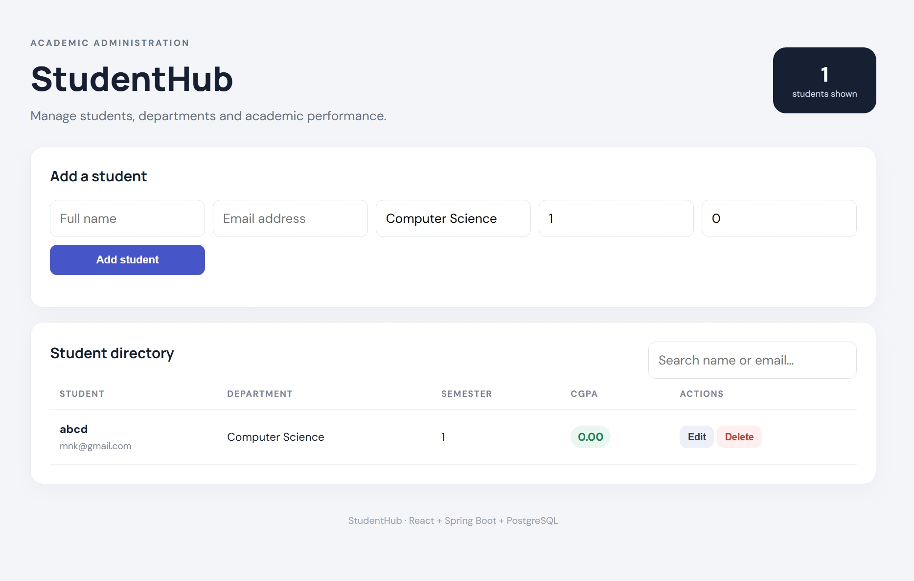

# StudentHub — Student Management System

A full-stack student management application built with React, Spring Boot, and PostgreSQL.

## Features

- Create, view, update, and delete student records
- Input validation and duplicate email prevention
- Search students by name or email
- Track semester and CGPA
- Student summary endpoint

## Technology Stack

- **Frontend:** React, Vite
- **Backend:** Java 21, Spring Boot
- **Database:** PostgreSQL
- **API:** REST API
- **Containerization:** Docker and Docker Compose

## Screenshots

### StudentHub Dashboard



## Run Locally

### Prerequisites

- Docker Desktop
- Git

### Start the application

```bash
git clone https://github.com/codewithsayan7/studenthub-springboot-react.git
cd studenthub-springboot-react
docker compose up --build
```

### Application URLs

| Service | URL |
|---|---|
| Frontend | http://localhost:5173 |
| Backend API | http://localhost:8080 |
| Students API | http://localhost:8080/api/students |

## Project Structure

```text
studenthub/
├── backend/
├── frontend/
├── screenshots/
├── docker-compose.yml
└── README.md
```

## Author

**Sayan Banerjee**

GitHub: [@codewithsayan7](https://github.com/codewithsayan7)
